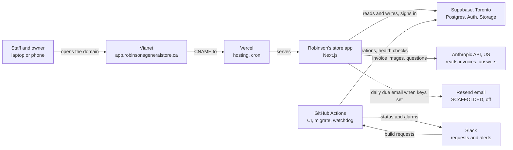
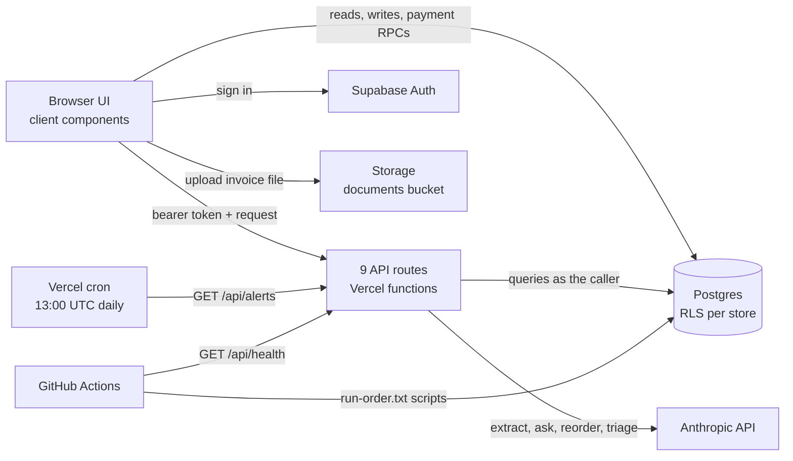
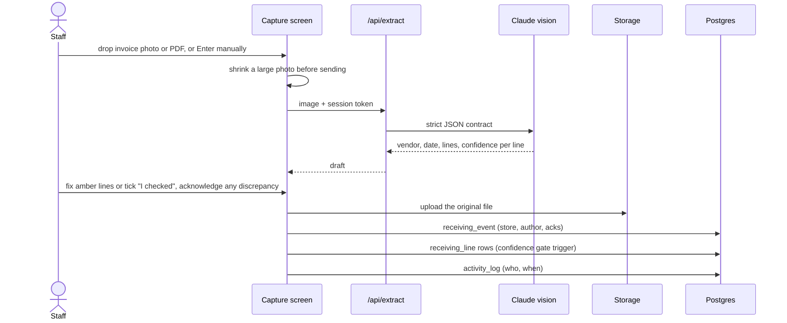
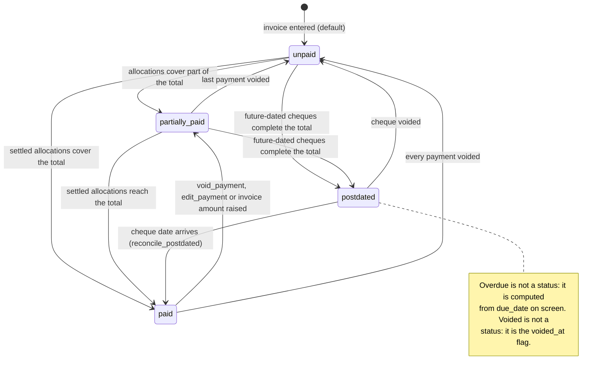
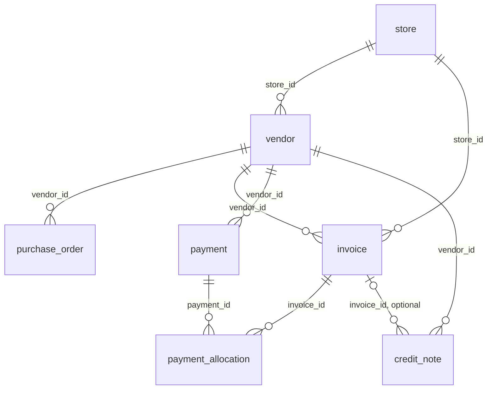
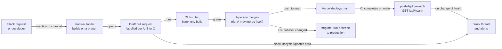

# Architecture: what runs where, and how money and changes move through it

Status: PROPOSED, 2026-10-24. Owner: the developer. Approver: Ravi Kiran.

**The store's app is one Next.js site on Vercel talking to one Supabase database in Toronto,
with the Anthropic API reading invoices and GitHub Actions plus Slack building, migrating and
watching it.** The one thing to know before changing anything: an invoice's paid status is
never typed, it is derived in the database from payment allocations by the payment engine,
so every money change goes through those functions or it is wrong.

Evidence tags follow `.claude/skills/store-standards/SKILL.md`: `[R path:line]` read from
this repository this session, `[V-run]` checked live this session, `[J-open]` believed and
not checked (with what would prove it wrong), `[Q: owner]` an open question. States: BUILT,
PARTIAL (gaps named), SCAFFOLDED (built, switched off; the switch named), TARGET (not built).

## 1. Context

The store is Robinson's General Store, the general store Ravi Kiran acquired, in Dorset,
Ontario. Heavy summer seasonality. Lakeside Dry Goods and L_S and Dry goods are a section
inside it, not the store name [R .claude/skills/robinsons-store/SKILL.md:12].

Who uses it: floor staff capture deliveries and count stock; leads, managers and the owner
also see money [R src/lib/auth.ts:38-40]. The four roles are `staff`, `lead`, `manager`,
`owner` [R supabase/schema.sql:29]. The owner runs the store remotely, mostly from a phone.

What it touches: the store's vendor ledger, orders, invoices, payments, receiving records,
inventory counts, maintenance, compliance and HR records, all in one Postgres database
[R supabase/schema.sql:7-660].

Question: which outside services does the store's app depend on, and for what?

Plain flow: staff and the owner open app.robinsonsgeneralstore.ca, which Vianet's DNS points
at the app on Vercel; the app keeps all records in Supabase in Toronto and sends invoice
images and questions to Anthropic. Separately, Slack requests and GitHub Actions build the
app, apply database scripts and watch the live site, reporting back to Slack.

Facts behind the picture:

- Vercel hosts the app, deploys on push and runs one daily cron. BUILT. The plan is Hobby,
  which does not license commercial use [R docs/PLATFORM.md:25-44, 74].
- Supabase holds Postgres, Auth and the `documents` storage bucket in ca-central Toronto on
  the Free plan, which takes no backups. BUILT [R docs/PLATFORM.md:46-64, 75].
- The custom domain `app.robinsonsgeneralstore.ca` is live, verified 2026-08-11. BUILT
  [R docs/PLATFORM.md:88]. Vianet has no self-serve DNS editor; changes are a phone call
  [R docs/PLATFORM.md:78]. The domain was due to renew 2026-10-16 and nobody has seen it
  renew [R docs/HANDOVER.md:231].
- Anthropic is US-hosted and pay as you go [R docs/PLATFORM.md:76].
- Resend: the code exists and is off until keys are set; it has never been configured.
  SCAFFOLDED, switch is `RESEND_API_KEY`, `ALERT_EMAIL_FROM`, `ALERT_EMAIL_TO` in Vercel
  [R src/app/api/alerts/route.ts:98-105] [R docs/STATUS.md:392-393].
- Slack carries build requests in and watchdog and migration messages out, through a bot app
  and an incoming webhook. BUILT [R docs/PLATFORM.md:80].

## 2. Containers

Question: what are the deployable pieces, and how do they talk to each other?

Plain flow: the browser signs in with Supabase Auth and reads and writes the database
directly, store-scoped by row-level security; anything that needs a secret (the AI key, the
service role) goes through one of nine API routes on Vercel. GitHub Actions applies database
scripts directly and checks the live app through `/api/health`.

The nine API routes. All BUILT; each exports `preferredRegion = "yul1"`:

| Route | Does | Who may call | Evidence |
|---|---|---|---|
| `/api/extract` | Claude vision reads an invoice image into a strict JSON contract with a confidence per line | Signed-in member when login is enforced | [R src/app/api/extract/route.ts:9, 11-28, 69] |
| `/api/ask` | Answers from the store's notes, vendors and invoices; withholds invoices from non-money roles | Signed-in member | [R src/app/api/ask/route.ts:14, 36, 44-50, 91] |
| `/api/reorder` | Plain-language summary of the formula reorder list | Money roles once login is enforced | [R src/app/api/reorder/route.ts:12, 33] |
| `/api/feedback-triage` | Describes a screenshot attached to a suggestion into `feedback.ai_summary` | Signed-in member | [R src/app/api/feedback-triage/route.ts:10, 89] |
| `/api/alerts` | Daily due-date email of unpaid and partially paid invoices; guarded by `CRON_SECRET` | The Vercel cron | [R src/app/api/alerts/route.ts:12, 23-44, 53-54] [R vercel.json:3-5] |
| `/api/health` | Pass or fail on database reachability, the owed-total rule, the payment engine, status drift and required columns; never returns a dollar figure | Anyone; detail only with `CRON_SECRET` | [R src/app/api/health/route.ts:11, 22-24, 148-258] |
| `/api/import` | Loads the bookings, schedule or inventory workbook | Owner or manager | [R src/app/api/import/route.ts:14, 450-451] |
| `/api/export` | One Excel workbook, a tab per table | Owner or manager | [R src/app/api/export/route.ts:10, 83] |
| `/api/admin/users` | Creates and removes staff logins with the service role, forced to the caller's store | Owner or manager | [R src/app/api/admin/users/route.ts:8, 32, 69, 139] |

AI routes: default model `claude-sonnet-5`, `ANTHROPIC_MODEL` overrides; no temperature is
sent, on purpose, because current models reject non-default sampling; text answers go
through `plainText()` [R src/app/api/ask/route.ts:39, 152, 166] [R src/app/api/reorder/route.ts:23, 110]
[R src/app/api/feedback-triage/route.ts:38, 86]. BUILT.

Region: every route asks for Montreal (`yul1`) in code, and the developer set Function Region to Montreal in the Vercel dashboard on 2026-08-17 [R docs/STATUS.md:101-102]. BUILT:
production runs in Montreal [V-run, `curl -sD- -o /dev/null https://app.robinsonsgeneralstore.ca/api/health`, `x-vercel-id: cle1::yul1::...`, 2026-10-24].
The header reads `<edge>::<function region>::<id>`, so the region is the second field; the first is the Vercel edge nearest the caller and varies.
Whether the code export alone would also work is unknown: the August readings of `iad1` that
called it a no-op did not record which field they read [R docs/STATUS.md:85].

## 3. The capture loop

Question: how does an invoice photo become a posted receiving record?

Plain flow: the photo is shrunk if large and read by Claude into a draft with a confidence per
line; a person fixes or confirms every low-confidence line, then the original file is
uploaded and the receiving event, its lines and an audit row are written.

- The photo is downscaled before sending so a phone picture does not exceed the request body
  limit; the stored file is the original. BUILT [R src/app/capture/page.tsx:114-122].
- Save is blocked until any discrepancy and any amber line is acknowledged
  [R src/app/capture/page.tsx:190-193]. The database refuses a line under 0.7 confidence
  with a unit cost unless the event carries `low_confidence_ack`. BUILT
  [R supabase/edit_delete.sql:80-100].
- Order of writes: file upload first, then `receiving_event`, then `receiving_line`, then
  `activity_log` [R src/app/capture/page.tsx:199-238]. These are four separate requests from
  the browser, not one transaction (see ARCH-07).
- Capture writes no `invoice` row; invoices are entered on the vendor and money screens.
  BUILT [R src/app/capture/page.tsx:205-238].

## 4. Money: how an invoice's status moves

Question: what decides whether an invoice reads unpaid, partially paid, post-dated or paid?

Plain flow: the database adds up an invoice's allocations from payments that are not voided,
splitting them into money already gone (paid date today or earlier, or no date) and money
on future-dated cheques, and sets one of four statuses from that; overdue and voided sit
beside the status and never replace it.

How the engine actually derives it. BUILT:

- Four stored statuses only: `unpaid`, `partially_paid`, `paid`, `postdated`
  [R supabase/schema.sql:166] [R supabase/payments_v2.sql:40-42].
- Total owed is amount plus freight plus HST, except HST is not added when `tax_mode` is
  `included` [R supabase/payments_v2.sql:81-89].
- Settled is the sum of allocations whose payment date is today or earlier in Toronto time,
  or null; scheduled is the sum dated in the future; voided payments count for nothing
  [R supabase/payments_v2.sql:111-117].
- The rule, in order: total of zero or less reads `paid` if any money is allocated, else
  `unpaid`; settled at or above total is `paid`; settled plus scheduled at or above total is
  `postdated`; anything above zero is `partially_paid`; otherwise `unpaid`
  [R supabase/payments_v2.sql:119-129]. So an invoice partly paid with a post-dated cheque
  that does not finish it reads `partially_paid`.
- `order_invoice_fields.sql`, the latest script that touches this, re-creates the same
  function with the same rule and re-derives every invoice once
  [R supabase/order_invoice_fields.sql:66-121].
- Post-dated is a future `paid_date` on a payment, never a method; the method list is cash,
  cheque, four card types, e-transfer, EFT, other, plus legacy `cc`
  [R supabase/schema.sql:181-182].

What moves it:

| Trigger | Effect | Evidence |
|---|---|---|
| `record_payment` | Inserts the payment and its allocations, re-derives each touched invoice, writes audit rows, one transaction | [R supabase/payments_v2.sql:140-195] |
| `void_payment` | Sets `voided_at` on the payment (soft void) and re-derives every invoice it touched | [R supabase/payments_v2.sql:198-221] |
| `edit_payment` | Changes date, method, reference, notes, filing; never the amount; re-derives, because a date change moves money between settled and post-dated | [R supabase/payments_v2.sql:223-267] |
| `reconcile_postdated` | Re-derives every non-voided `postdated` invoice; called on load by editors, no cron | [R supabase/payments_v2.sql:271-286] [R src/app/overdue/page.tsx:40-42] |
| Invoice edited on the vendor page | Calls `recompute_invoice_status` right after the save | [R src/app/vendors/[id]/page.tsx:519-521] |
| Legacy insert with `invoice_id` | Trigger creates the allocation and re-derives | [R supabase/payments_v2.sql:290-313] |

Beside the status:

- Overdue: `daysOverdue()` against `due_date`, shown as a red chip; never stored
  [R src/lib/format.ts:33-47] [R supabase/schema.sql:165]. The Overdue screen lists
  `unpaid`, `partially_paid` and `postdated`, and shows post-dated as "post-dated" rather
  than overdue [R src/app/overdue/page.tsx:46-47, 149-153]. The daily email covers `unpaid`
  and `partially_paid` only [R src/app/api/alerts/route.ts:53-54].
- Voided invoice: `voided_at` set by `voidRow`; the row drops out of every list
  [R src/lib/edit.ts:17-22] [R supabase/schema.sql:666-681].
- Credit notes (`pending`, `applied`, `disputed`) do not change the status or the owed
  total; the engine never reads `credit_note` [R supabase/schema.sql:207-217]
  [R supabase/payments_v2.sql:105-117]. See ARCH-08.

## 5. Data

Question: how do the money tables connect, and which column ties each to a store?

Plain flow: a store has vendors and invoices; a vendor has orders, invoices, payments and
credit notes; one payment splits across one or more invoices through payment_allocation,
which is how a single cheque settles several invoices.

- Table names are real: `store`, `vendor`, `purchase_order`, `invoice`, `payment`,
  `payment_allocation`, `credit_note` [R supabase/schema.sql:7, 34, 134, 175, 194, 207, 516].
- `purchase_order` and `invoice` also carry `store_id` [R supabase/schema.sql:136, 518];
  `credit_note` does too [R supabase/schema.sql:209]. There is no foreign key between
  `invoice` and `purchase_order`; an invoice carries `po_number` as text
  [R supabase/schema.sql:160].
- Every amount column is `numeric` dollars: `invoice.amount`, `hst_amount`,
  `freight_charges`, `payment.amount`, `payment_allocation.amount`,
  `credit_note.credit_amount`, `purchase_order.order_amount`. BUILT
  [R supabase/schema.sql:141-143, 179, 198, 213, 522]. The header comment still says to
  move to cents before production [R supabase/schema.sql:3]; see ARCH-09.
- Nothing in `schema.sql` uses vectors; the only extension created is `pgcrypto`
  [R supabase/schema.sql:5]. pgvector for Ask the store is TARGET, deferred until the data
  outgrows one prompt [R docs/PLATFORM.md:123].

The store-scoping rule. BUILT: every read filters by the active `store_id` and every insert
stamps it; child tables scope through their parent [R .claude/skills/robinsons-store/SKILL.md:122].
At the database, 14 tables carry their own `store_id` policy [R supabase/auth_setup.sql:107-126];
`payment` scopes through its vendor (or legacy invoice), `payment_allocation` through its
payment, and `receiving_line`, `inventory_count_line`, `pay_rate`, `shift`, `retail_price`
through their parents [R supabase/auth_setup.sql:135-232]. A new table needs a policy in
`schema.sql`, in `auth_setup.sql` section 3a, and in a migration for live databases
[R CLAUDE.md:31-32].

Soft voids only: `voided_at` and `voided_by` sit on 13 tables from one loop plus `credit_note`
and `feedback`; shifts are the one hard delete [R supabase/schema.sql:220-221, 241-242, 666-681].

## 6. Build and release

Question: how does a change travel from a request to the live store?

Plain flow: a request in Slack becomes a draft pull request labelled with its tier; CI runs
the three gates; a person merges, or a words-only change merges itself once switched on; Vercel deploys main, migrate applies any merged database scripts, and the watchdog
asks the live site whether it is healthy and tells Slack when that changes.

| Step | What happens | State | Evidence |
|---|---|---|---|
| Slack request | Sweeps every 30 minutes; an idle sweep spends no model tokens; builds with `claude-sonnet-5`, at most 60 turns; stops and explains on payments, RPCs, auth, RLS or deletes; always opens a DRAFT pull request; merges only tier A (see below) | BUILT | [R .github/workflows/slack-autopilot.yml:7-31, 57, 167, 179-195] |
| Status card | Updates the Slack thread through review, checks, merge and live, for `claude/slack-*` branches only | BUILT | [R .github/workflows/slack-lifecycle.yml:3-16, 18-25] |
| Tier classifier | Script that sorts a diff into A (prose files only, may self-merge), B (app, person merges), C (money, access, database, configuration, automation, and every agent instruction file at any depth; never merges). The Slack loop runs it in a separate job, on a fresh runner, on every pull request it opens and labels the pull request with the tier | PARTIAL: rules tested, not yet run on a live request | [R .github/scripts/classify-change.mjs:25-75] [R .github/workflows/slack-autopilot.yml:197-282] [R .github/workflows/ci.yml:49] |
| Tier A self-merge | Starts CI on the head commit, waits, reads the pull request again (open, same commit, same base), merges with the commit pinned; fails closed (ADR-002) | SCAFFOLDED, switch is `AUTOMERGE_TIER_A` = `true` | [R .github/workflows/slack-autopilot.yml:284-343] |
| CI gates | `npm run lint`, `npx tsc --noEmit`, `npm run build` with blank Supabase env, plus the automation's own tests | BUILT | [R .github/workflows/ci.yml:3-13, 36-55] |
| Merge | A person merges, except tier A once switched on. Changes under `.github/` and `.claude/` never merge on their own | BUILT | [R docs/LOOP_ENGINEERING.md:65-103] |
| Deploy | Vercel deploys on push to main; every PR gets a preview | BUILT | [R docs/PLATFORM.md:74, 86-87] |
| Migrate | On push to main touching `supabase/**`, applies `supabase/run-order.txt` in order; `schema.sql`, `seed.sql` and `auth_setup.sql` are excluded on purpose | BUILT | [R .github/workflows/migrate.yml:33-39, 131] [R supabase/run-order.txt:10-16] |
| Watchdog | After CI completes on main and every two hours, calls `/api/health` and posts to Slack only when the answer changes; checks `PRODUCTION_URL` or falls back to the vercel.app address | BUILT | [R .github/workflows/post-deploy-watch.yml:16-22, 54] |
| RLS audit | Weekly, Monday 12:23 UTC: lists public tables with RLS off or empty, tells Slack, goes red | BUILT | [R .github/workflows/rls-audit.yml:1-17] |
| Dev site and promotion | `promote.yml` merges `develop` into `main` when a person runs it; inert because no `develop` branch exists | SCAFFOLDED, switch is creating `develop` and the dev Supabase project | [R .github/workflows/promote.yml:16-24, 47-53] [V-run, git ls-remote --heads origin, 2026-10-24: main and two claude/ branches, no develop] |
| Manual tools | `vercel-diagnose`, `vercel-protect`, `slack-announce` run by hand | BUILT | [R docs/PLATFORM.md:79, 100] |

Working in Claude Code: the `robinsons-store` and `store-standards` skills load from
`.claude/skills/`; a Stop hook refuses to end a turn while TypeScript is broken
[R .claude/settings.json:14-19]; update docs/STATUS.md and docs/VERIFICATION.md in the same
pull request as the work [R CLAUDE.md:21-22]. Human review of every dollar field stays
non-negotiable.

## 7. Security and privacy

Store data is fenced by store at the database; money is fenced by role in the app and API but
not yet at the database (ARCH-03).

- Row-level security, repository default: a fresh install from `schema.sql` gets the open
  demo policy set (`dev_all`, anon read and write on every table) and a public `documents`
  bucket [R supabase/schema.sql:683-712]. BUILT, for demos only.
- Row-level security, production: the cutover in `auth_setup.sql` is applied: 21
  `member_store_rw` policies, no open dev policies, the `documents` bucket private, one login
  account [R docs/STATUS.md:15-17, 388-391]. That was read live on 2026-10-18 and not re-read
  this session [J-open: killed if `select count(*) from pg_policies where policyname =
  'dev_all'` returns more than 0].
- Login enforcement in the app is the build-time flag `NEXT_PUBLIC_REQUIRE_AUTH`; with it on,
  every API route requires a valid session and queries run as the caller
  [R src/lib/serverMember.ts:3-10, 35-50]. Its production value was not read this session
  [Q: the developer, confirm it is `true` in Vercel production].
- Roles and money: `canSeeMoney` lets `lead`, `manager`, `owner` see costs and amounts, and
  treats an unknown role as staff, so money fails closed in the UI
  [R src/lib/auth.ts:34-40]; the API routes apply the same rule
  [R src/lib/serverMember.ts:18-21]. PARTIAL: the database policies scope by store, not by
  role [R supabase/auth_setup.sql:122-126], so a staff session could read amounts by calling
  the database directly (ARCH-03).
- Documents: private bucket, readable and writable by any signed-in member; read through
  signed, expiring URLs [R supabase/auth_setup.sql:315-331]. Not store-scoped (ARCH-04).
- Audit trail: members may only insert `activity_log` rows attributed to themselves and have
  no update or delete policy [R supabase/auth_setup.sql:297-315]. BUILT.
- Service role key: server-side only, used by `/api/admin/users`, `/api/import`,
  `/api/alerts`, `/api/health` [R src/app/api/admin/users/route.ts:32]
  [R src/app/api/import/route.ts:417] [R src/app/api/alerts/route.ts:35]
  [R src/app/api/health/route.ts:112].
- PIPEDA and staff data: the AI routes read notes, vendors, invoices and orders, never
  employee, pay or shift tables [R src/app/api/ask/route.ts:44-50]
  [R src/app/api/reorder/route.ts:44-46]. BUILT.
- Canadian regions: records and invoice images live in Toronto; invoice images go to
  Anthropic in the US to be read; the owner was told this in writing
  [R docs/owner-notes/store-app-infrastructure.html:470-517]. Function processing runs in
  Montreal (section 2; ARCH-01 closed 2026-10-24).

## 8. What is deliberately not here

Not the enterprise stack: no Snowflake, Fabric, Redpanda, MuleSoft, API gateway or MCP
governance at this scale. One store, thousands of rows a month; the upgrade path is earned
only if the business grows to many stores [R .claude/skills/robinsons-store/SKILL.md:25]
[R robinsons_store_build_spec.md:158]. Budget: $50 to $100 a month typical against a $200
ceiling [R docs/PLATFORM.md:13-14].

Also TARGET or declined, with the reasons in docs/PLATFORM.md:

| Capability | State | Evidence |
|---|---|---|
| pgvector for Ask the store | TARGET, deferred | [R docs/PLATFORM.md:123] |
| GPT-4o fallback, AWS Textract | TARGET, deferred | [R .claude/skills/robinsons-store/SKILL.md:23] |
| SMS alerts | TARGET | No SMS code exists [V-run, grep -ril "twilio\|sms" src/, 2026-10-24: no matches] |
| Email invoice intake (AgentMail) | Installed, not wired | [R docs/PLATFORM.md:82] |
| Supabase Edge Functions, Realtime | Declined | [R docs/PLATFORM.md:121-122] |
| Vercel AI Gateway, Blob, Workflows | Declined | [R docs/PLATFORM.md:112-114] |

## 9. Open items

| ID | Item | Owner | Blocking? |
|---|---|---|---|
| ARCH-01 | CLOSED 2026-10-24: Montreal function region confirmed, `x-vercel-id` second field reads `yul1` | The developer | No |
| ARCH-02 | `NEXT_PUBLIC_REQUIRE_AUTH` production value not read this session | The developer | No |
| ARCH-03 | Money is hidden from staff in the UI and API only; database policies are store-scoped, not role-scoped | The developer | Yes, before staff logins are made |
| ARCH-04 | `documents` bucket open to any signed-in member, not scoped by store | The developer | No while there is one store |
| ARCH-05 | Supabase Free takes no backups (docs/PLATFORM.md risk 2; HANDOVER Step 2) | Ravi Kiran | Yes |
| ARCH-06 | Vercel Hobby does not license commercial use (risk 1; HANDOVER Step 3) | Ravi Kiran | Yes |
| ARCH-07 | Capture writes four separate requests; a failure part way leaves a stored file with no event, or an event with no lines | The developer | No |
| ARCH-08 | Credit notes do not reduce what the engine says is owed or change status. Intended? [Q: Ravi Kiran] | Ravi Kiran | No |
| ARCH-09 | `schema.sql:3` still says move to integer cents before production; production runs `numeric`. Keep or migrate? [Q: the developer] | The developer | No |
| ARCH-10 | ~~Tier A self-merge described in docs/LOOP_ENGINEERING.md section 3 is not wired into the live Slack loop~~ Closed 2026-10-24 by ADR-002: wired, off until `AUTOMERGE_TIER_A` is set | The developer | No |
| ARCH-11 | Domain renewal due 2026-10-16 not yet seen (HO-01) | Ravi Kiran | Yes, for the domain |

## 10. How this maps to the rest of the docs

Every service and plan, adopted or declined: docs/PLATFORM.md. Who holds each account and
every secret: docs/HANDOVER.md. The AI agents and whose key each runs on: docs/AGENTS.md.
How the automation builds, ships and watches, and why each limit exists:
docs/LOOP_ENGINEERING.md and docs/SLACK_AUTOPILOT.md. Dev and production:
docs/ENVIRONMENTS.md. SQL scripts and run order: docs/SUPABASE_SETUP.md and
`supabase/run-order.txt`. Build state and sign-off: docs/STATUS.md and docs/VERIFICATION.md.
The rules every change follows: CLAUDE.md and `.claude/skills/robinsons-store/SKILL.md`;
the design system: `.claude/skills/robinsons-store/references/design-tokens.md`.

**Basis: 116 claims checked this session (2026-10-24), 108 confirmed, 8 killed, 42 sources.**
Opened: the SQL in `supabase/` (schema, payments_v2, order_invoice_fields, credit_notes,
edit_delete, auth_setup, run-order), all nine route files, five `src/lib` helpers, the
capture, overdue and vendor pages, `vercel.json`, nine workflow files and the classifier,
`.claude/settings.json`, CLAUDE.md, the robinsons-store skill, and docs PLATFORM, AGENTS,
HANDOVER, ENVIRONMENTS, LOOP_ENGINEERING, STATUS, README and the owner infrastructure note;
the eight killed are the six stale statements this rewrite replaces, the old diagram's upload
after the database writes, and tier A self-merge in the live Slack loop. Added the same day
by a later session: 1 claim checked, 1 confirmed, the Montreal region (ARCH-01), from a live
curl of the health route.
Amended 2026-10-24 by ADR-002: section 6 and ARCH-10 re-read against the changed workflow and
script, 6 claims checked, 6 confirmed. Source: this repository.
