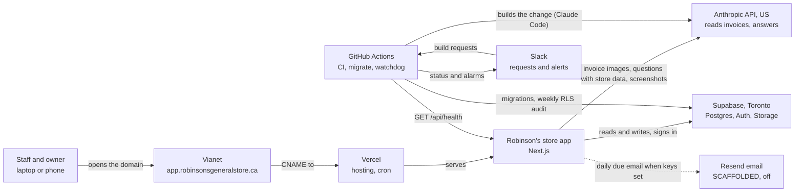
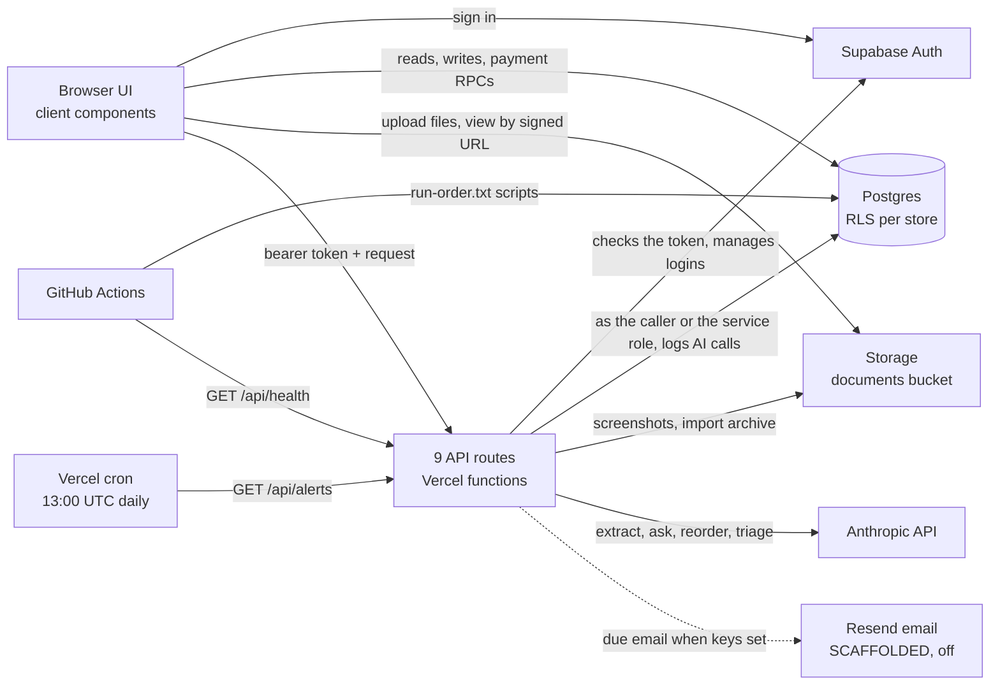
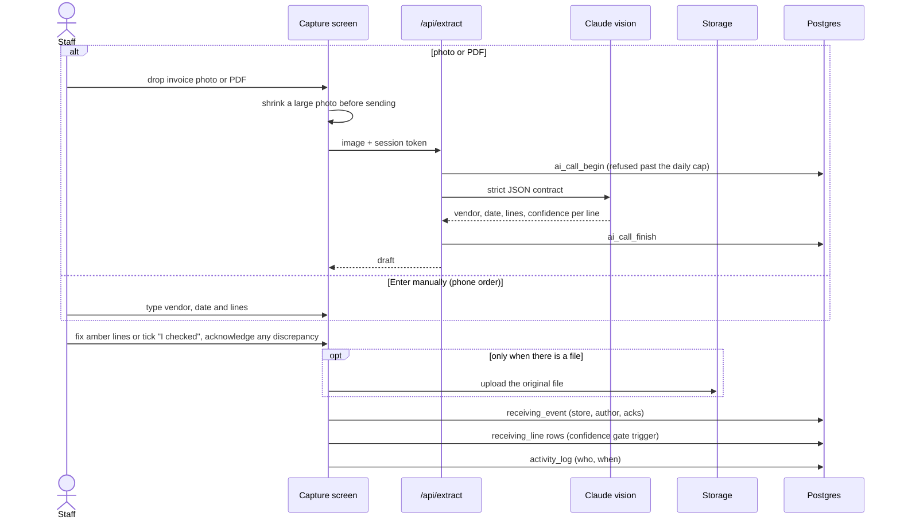
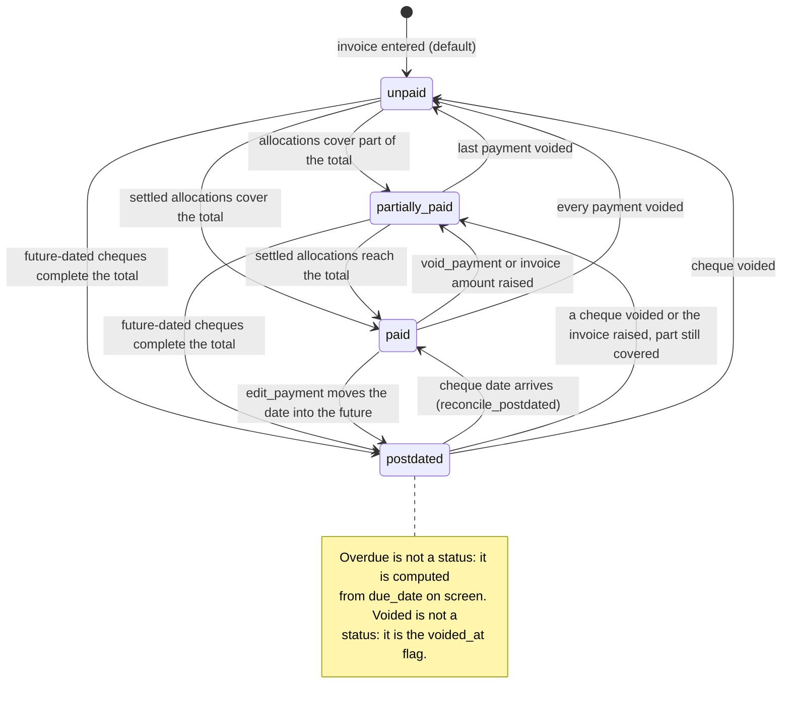
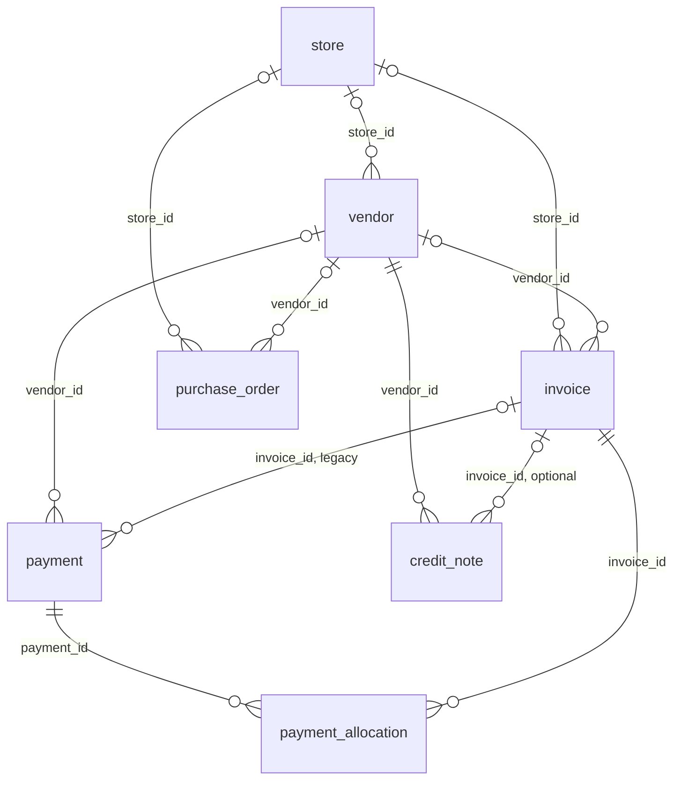
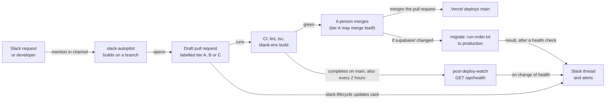

# Architecture: what runs where, and how money and changes move through it

Status: PROPOSED, 2026-10-24, diagrams corrected against the code 2026-10-30. Owner: the developer. Approver: Ravi Kiran.

**The store's app is one Next.js site on Vercel talking to one Supabase database in Toronto,
with the Anthropic API reading invoices and GitHub Actions plus Slack building, migrating and
watching it.** The one thing to know before changing anything: an invoice's paid status is
never typed, it is derived in the database from payment allocations by the payment engine,
so every money change goes through those functions or it is wrong.

Evidence tags follow `.claude/skills/store-standards/SKILL.md`: `[R path:line]` read from
this repository this session, `[V-run]` checked live this session, `[J-open]` believed and
not checked (with what would prove it wrong), `[Q: owner]` an open question. States: BUILT,
PARTIAL (gaps named), SCAFFOLDED (built, switched off; the switch named), TARGET (not built).

## 1. Context

The store is Robinson's General Store, the general store Ravi Kiran acquired, in Dorset,
Ontario. Heavy summer seasonality. Lakeside Dry Goods and L_S and Dry goods are a section
inside it, not the store name [R .claude/skills/robinsons-store/SKILL.md:12].

Who uses it: floor staff capture deliveries and count stock; leads, managers and the owner
also see money [R src/lib/auth.ts:38-40]. The four roles are `staff`, `lead`, `manager`,
`owner` [R supabase/schema.sql:29]. The owner runs the store remotely, mostly from a phone.

What it touches: the store's vendor ledger, orders, invoices, payments, receiving records,
inventory counts, maintenance, compliance and HR records, all in one Postgres database
[R supabase/schema.sql:7-660].

Question: which outside services does the store's app depend on, and for what?

Plain flow: staff and the owner open app.robinsonsgeneralstore.ca, which Vianet's DNS points
at the app on Vercel; the app keeps all records in Supabase in Toronto and sends invoice
images, questions with the store's notes and records, and feedback screenshots to Anthropic.
Separately, a Slack request starts a GitHub Actions build that also calls Anthropic; Actions
applies database scripts and audits row-level security directly in Supabase, asks the live app
whether it is healthy, and reports back to Slack.

Facts behind the picture:

- Vercel hosts the app, deploys on push and runs one daily cron. BUILT. The plan is Hobby,
  which does not license commercial use [R docs/PLATFORM.md:25-44, 74].
- Supabase holds Postgres, Auth and the `documents` storage bucket in ca-central Toronto on
  the Free plan, which takes no backups. BUILT [R docs/PLATFORM.md:46-64, 75].
- The custom domain `app.robinsonsgeneralstore.ca` is live, verified 2026-08-11. BUILT
  [R docs/PLATFORM.md:88]. Vianet has no self-serve DNS editor; changes are a phone call
  [R docs/PLATFORM.md:78]. The domain was due to renew 2026-10-16 and nobody has seen it
  renew [R docs/HANDOVER.md:231].
- Anthropic is US-hosted and pay as you go [R docs/PLATFORM.md:76].
- Resend: the code exists and is off until keys are set; it has never been configured.
  SCAFFOLDED, switch is `RESEND_API_KEY`, `ALERT_EMAIL_FROM`, `ALERT_EMAIL_TO` in Vercel
  [R src/app/api/alerts/route.ts:98-105] [R docs/STATUS.md:392-393].
- Slack carries build requests in and watchdog and migration messages out, through a bot app
  and an incoming webhook. BUILT [R docs/PLATFORM.md:80].
- The Slack build runs Claude Code in GitHub Actions on the app's Anthropic key
  [R .github/workflows/slack-autopilot.yml:138-140]. Migrations and the RLS audit connect to the
  database with `psql` [R .github/workflows/migrate.yml:150] [R .github/workflows/rls-audit.yml:43];
  the health watchdog calls the app, not the database [R .github/scripts/health-check.mjs:33].
  BUILT.

## 2. Containers

Question: what are the deployable pieces, and how do they talk to each other?

Plain flow: the browser signs in with Supabase Auth, reads and writes the database directly,
store-scoped by row-level security, and uploads and views documents in Storage; anything that
needs a secret (the AI key, the service role) goes through one of nine API routes on Vercel.
Most routes query as the signed-in caller; admin users, alerts and health use the service
role, and import uses it when its key is set. GitHub Actions applies database scripts directly and checks the live app through
`/api/health`.

- Routes check the caller's token with Supabase Auth [R src/lib/serverMember.ts:54]
  [R src/app/api/admin/users/route.ts:53]. Feedback triage downloads the screenshot from
  Storage and import archives every uploaded workbook there
  [R src/app/api/feedback-triage/route.ts:56] [R src/app/api/import/route.ts:26]. Documents are
  viewed through signed URLs, with a public-URL fallback in demo mode [R src/lib/docs.ts:15, 21].
  The alerts route calls Resend directly when its keys are set [R src/app/api/alerts/route.ts:98].
  BUILT.

The nine API routes. All BUILT; each exports `preferredRegion = "yul1"`:

| Route | Does | Who may call | Evidence |
|---|---|---|---|
| `/api/extract` | Claude vision reads an invoice image into a strict JSON contract with a confidence per line | Signed-in member when login is enforced | [R src/app/api/extract/route.ts:9, 11-28, 69] |
| `/api/ask` | Answers from the store's notes, vendors and invoices; withholds invoices from non-money roles | Signed-in member | [R src/app/api/ask/route.ts:14, 36, 44-50, 91] |
| `/api/reorder` | Plain-language summary of the formula reorder list | Money roles once login is enforced | [R src/app/api/reorder/route.ts:12, 33] |
| `/api/feedback-triage` | Describes a screenshot attached to a suggestion into `feedback_summary`, which opens to the people who may open the screenshot (ADR-005) | Signed-in member who may open the screenshot | [R src/app/api/feedback-triage/route.ts:30, 56, 85-89] |
| `/api/alerts` | Daily due-date email of unpaid and partially paid invoices; guarded by `CRON_SECRET` | The Vercel cron | [R src/app/api/alerts/route.ts:12, 23-44, 53-54] [R vercel.json:3-5] |
| `/api/health` | Pass or fail on database reachability, the owed-total rule, the payment engine, status drift and required columns; never returns a dollar figure | Anyone; detail only with `CRON_SECRET` | [R src/app/api/health/route.ts:11, 22-24, 148-258] |
| `/api/import` | Loads the bookings, schedule or inventory workbook | Owner or manager | [R src/app/api/import/route.ts:14, 450-451] |
| `/api/export` | One Excel workbook, a tab per table | Owner or manager | [R src/app/api/export/route.ts:10, 83] |
| `/api/admin/users` | Creates and removes staff logins with the service role, forced to the caller's store | Owner or manager | [R src/app/api/admin/users/route.ts:8, 32, 69, 139] |

AI routes: default model `claude-sonnet-5`, `ANTHROPIC_MODEL` overrides; no temperature is
sent, on purpose, because current models reject non-default sampling; text answers go
through `plainText()` [R src/app/api/ask/route.ts:39, 152, 166] [R src/app/api/reorder/route.ts:23, 110]
[R src/app/api/feedback-triage/route.ts:82]. BUILT.

AI usage log and daily cap. BUILT: every model call goes through `callClaude`
[R src/lib/anthropic.ts:66], which reserves a row in `ai_call` before the model is asked and
records how it ended afterwards [R src/lib/anthropic.ts:70, 152, 158], through the database
functions `ai_call_begin` and `ai_call_finish` [R supabase/ai_call.sql:37-69, 73-108]. A row
holds the store, route, model, token counts, duration and outcome, never the prompt, the store
data sent with it or the answer [R supabase/ai_call.sql:4-8, 11-24]. Each store may make
`AI_DAILY_CAP_PER_STORE` calls per Ontario calendar day, default 100
[R src/lib/aiUsage.ts:24-28] [R supabase/ai_call.sql:55-58]; past that the call is refused
before it reaches the model and logged as `capped` [R supabase/ai_call.sql:59-62]. If the log
cannot be reached the call still goes through: the cap protects the monthly bill, not the
store's data [R src/lib/aiUsage.ts:10-13]. Reading the rows is PARTIAL: the owner-only read
policy lives in `auth_setup.sql` [R supabase/auth_setup.sql:148-152], which migrate does not
run [R supabase/run-order.txt:10-16], so it applies only when that file is rerun by hand in
the SQL editor. Whether it has been rerun on the live database since `ai_call` was added:
[Q: the developer].

Region: every route asks for Montreal (`yul1`) in code, and the developer set Function Region to Montreal in the Vercel dashboard on 2026-08-17 [R docs/STATUS.md:101-102]. BUILT:
production runs in Montreal [V-run, `curl -sD- -o /dev/null https://app.robinsonsgeneralstore.ca/api/health`, `x-vercel-id: cle1::yul1::...`, 2026-10-24].
The header reads `<edge>::<function region>::<id>`, so the region is the second field; the first is the Vercel edge nearest the caller and varies.
Whether the code export alone would also work is unknown: the August readings of `iad1` that
called it a no-op did not record which field they read [R docs/STATUS.md:85].

## 3. The capture loop

Question: how does an invoice photo become a posted receiving record?

Plain flow: a photo is shrunk if large and read by Claude into a draft with a confidence per
line, unless the store has used its daily AI allowance; a phone order is typed in instead and
never touches the AI or Storage. A person fixes or confirms every low-confidence line, then
any original file is uploaded and the receiving event, its lines and an audit row are written.

- Manual entry needs no file and skips the upload [R src/app/capture/page.tsx:193, 199-201].
  BUILT. The AI usage reserve and finish around the model call are in section 2
  [R src/lib/anthropic.ts:70, 152, 158].

- The photo is downscaled before sending so a phone picture does not exceed the request body
  limit; the stored file is the original. BUILT [R src/app/capture/page.tsx:114-122].
- Save is blocked until any discrepancy and any amber line is acknowledged
  [R src/app/capture/page.tsx:190-193]. The database refuses a line under 0.7 confidence
  with a unit cost unless the event carries `low_confidence_ack`. BUILT
  [R supabase/edit_delete.sql:41-61].
- Order of writes: file upload first, then `receiving_event`, then `receiving_line`, then
  `activity_log` [R src/app/capture/page.tsx:199-238]. These are four separate requests from
  the browser, not one transaction (see ARCH-07).
- Capture writes no `invoice` row; invoices are entered on the vendor and money screens.
  BUILT [R src/app/capture/page.tsx:205-238].

## 4. Money: how an invoice's status moves

Question: what decides whether an invoice reads unpaid, partially paid, post-dated or paid?

Plain flow: the database adds up an invoice's allocations from payments that are not voided,
splitting them into money already gone (paid date today or earlier, or no date) and money
on future-dated cheques, and sets one of four statuses from that; overdue and voided sit
beside the status and never replace it.

How the engine actually derives it. BUILT:

- Four stored statuses only: `unpaid`, `partially_paid`, `paid`, `postdated`
  [R supabase/schema.sql:166] [R supabase/payments_v2.sql:40-42].
- Total owed is amount plus freight plus HST, except HST is not added when `tax_mode` is
  `included` [R supabase/payments_v2.sql:81-89].
- Settled is the sum of allocations whose payment date is today or earlier in Toronto time,
  or null; scheduled is the sum dated in the future; voided payments count for nothing
  [R supabase/payments_v2.sql:111-117].
- The rule, in order: total of zero or less reads `paid` if any money is allocated, else
  `unpaid`; settled at or above total is `paid`; settled plus scheduled at or above total is
  `postdated`; anything above zero is `partially_paid`; otherwise `unpaid`
  [R supabase/payments_v2.sql:119-129]. So an invoice partly paid with a post-dated cheque
  that does not finish it reads `partially_paid`.
- `order_invoice_fields.sql`, the latest script that touches this, re-creates the same
  function with the same rule and re-derives every invoice once
  [R supabase/order_invoice_fields.sql:66-121].
- Post-dated is a future `paid_date` on a payment, never a method; the method list is cash,
  cheque, four card types, e-transfer, EFT, other, plus legacy `cc`
  [R supabase/schema.sql:181-182].

What moves it:

| Trigger | Effect | Evidence |
|---|---|---|
| `record_payment` | Inserts the payment and its allocations, re-derives each touched invoice, writes audit rows, one transaction | [R supabase/payments_v2.sql:140-195] |
| `void_payment` | Sets `voided_at` on the payment (soft void) and re-derives every invoice it touched | [R supabase/payments_v2.sql:198-221] |
| `edit_payment` | Changes date, method, reference, notes, filing; never the amount; re-derives, because a date change moves money between settled and post-dated | [R supabase/payments_v2.sql:223-267] |
| `reconcile_postdated` | Re-derives every non-voided `postdated` invoice; called on load by editors, no cron | [R supabase/payments_v2.sql:271-286] [R src/app/overdue/page.tsx:40-42] |
| Invoice edited on the vendor page | Calls `recompute_invoice_status` right after the save | [R src/app/vendors/[id]/page.tsx:519-521] |
| Legacy insert with `invoice_id` | Trigger creates the allocation and re-derives | [R supabase/payments_v2.sql:290-313] |

Beside the status:

- Overdue: `daysOverdue()` against `due_date`, shown as a red chip; never stored
  [R src/lib/format.ts:33-47] [R supabase/schema.sql:165]. The Overdue screen lists
  `unpaid`, `partially_paid` and `postdated`, and shows post-dated as "post-dated" rather
  than overdue [R src/app/overdue/page.tsx:46-47, 149-153]. The daily email covers `unpaid`
  and `partially_paid` only [R src/app/api/alerts/route.ts:53-54].
- Voided invoice: `voided_at` set by `voidRow`; the row drops out of every list
  [R src/lib/edit.ts:17-22] [R supabase/schema.sql:666-681].
- Credit notes (`pending`, `applied`, `disputed`) do not change the status or the owed
  total; the engine never reads `credit_note` [R supabase/schema.sql:207-217]
  [R supabase/payments_v2.sql:105-117]. See ARCH-08.

## 5. Data

Question: how do the money tables connect, and which column ties each to a store?

Plain flow: a store has vendors, orders and invoices; a vendor has orders, invoices, payments
and credit notes; one payment splits across zero or more invoices through payment_allocation,
which is how a single cheque settles several invoices and how a deposit waits with none.

- The store and vendor links are nullable foreign keys, so the database itself does not insist
  on a parent; the app always stamps them [R supabase/schema.sql:36, 136, 138, 177, 629, 630].
  An allocation always has its payment and invoice, and a credit note always has its vendor
  [R supabase/schema.sql:196-197, 210].
- `payment.invoice_id` is the legacy one-invoice link, still written by the bookings import; a
  trigger turns it into an allocation [R supabase/schema.sql:178]
  [R src/lib/importBookingsV2.ts:419-421] [R supabase/payments_v2.sql:290-313].
- `record_payment` accepts an amount with no allocations, a deposit
  [R supabase/payments_v2.sql:147, 159-163].
- Table names are real: `store`, `vendor`, `purchase_order`, `invoice`, `payment`,
  `payment_allocation`, `credit_note` [R supabase/schema.sql:7, 34, 134, 175, 194, 207, 627].
- `purchase_order` and `invoice` also carry `store_id` [R supabase/schema.sql:136, 629];
  `credit_note` does too [R supabase/schema.sql:209]. There is no foreign key between
  `invoice` and `purchase_order`; an invoice carries `po_number` as text
  [R supabase/schema.sql:160].
- Every amount column is `numeric` dollars: `invoice.amount`, `hst_amount`,
  `freight_charges`, `payment.amount`, `payment_allocation.amount`,
  `credit_note.credit_amount`, `purchase_order.order_amount`. BUILT
  [R supabase/schema.sql:141-143, 179, 198, 213, 633]. The header comment says the same, and integer cents is
  not planned [R supabase/schema.sql:3]; ARCH-09 is closed.
- Nothing in `schema.sql` uses vectors; the only extension created is `pgcrypto`
  [R supabase/schema.sql:5]. pgvector for Ask the store is TARGET, deferred until the data
  outgrows one prompt [R docs/PLATFORM.md:176].

The store-scoping rule. BUILT: every read filters by the active `store_id` and every insert
stamps it; child tables scope through their parent [R .claude/skills/robinsons-store/SKILL.md:121].
PARTIAL in the code: a few reads leave scoping to row-level security alone, for example the
capture screen's list of people (`app_user`) and the shared tax rules
[R src/app/capture/page.tsx:61, 77].
At the database, 14 tables carry their own `store_id` policy: nine in section 3a
[R supabase/auth_setup.sql:102-133] and the five that carry a dollar figure in section 3e,
which adds the role fence [R supabase/auth_setup.sql:315-331]. `inventory_count_line`,
`shift` and `retail_price` scope through their parents [R supabase/auth_setup.sql:159-198];
`payment` through its vendor (or legacy invoice), `payment_allocation` through its payment,
and `pay_rate` and `receiving_line` through theirs, all in 3e
[R supabase/auth_setup.sql:333-412]. `ai_call`, the AI usage log, is store-scoped in its own
block: the owner reads it, and nobody writes it except through its two functions
[R supabase/auth_setup.sql:135-157]. `feedback_summary`, the AI's description of a suggestion
screenshot, is store-scoped in section 3g and opens by the screenshot's rule (ADR-005)
[R supabase/auth_setup.sql:658-716]. `ai_call.sql` runs just before `money_by_role.sql`
[R supabase/run-order.txt:26-27]. A new table needs a policy in `schema.sql`, in
`auth_setup.sql` (3a, or 3e if it holds a dollar figure), and in a migration for live
databases [R CLAUDE.md:33-35].

Soft voids only: `voided_at` and `voided_by` sit on 13 tables from one loop plus `credit_note`
and `feedback`; shifts are the one hard delete [R supabase/schema.sql:220-221, 240-241, 776-792].

## 6. Build and release

Question: how does a change travel from a request to the live store?

Plain flow: a request in Slack becomes a draft pull request labelled with its tier; CI runs
the three gates; a person merges, or a words-only change merges itself once switched on; Vercel
deploys main and, separately, migrate applies any merged database scripts, asks the site
whether it is healthy and tells Slack. The watchdog runs when CI finishes on main (and every
two hours, or by hand), waits 90 seconds after a CI run, asks the live site whether it is
healthy and tells Slack when that changes. It does not confirm which deploy it is looking at.

| Step | What happens | State | Evidence |
|---|---|---|---|
| Slack request | Sweeps every 30 minutes; an idle sweep spends no model tokens; builds with `claude-sonnet-5`, at most 60 turns; stops and explains on payments, RPCs, auth, RLS or deletes; always opens a DRAFT pull request; merges only tier A (see below) | BUILT | [R .github/workflows/slack-autopilot.yml:7-31, 57, 167, 179-195] |
| Status card | Updates the Slack thread through review, checks and merge, for `claude/slack-*` branches only. "Live" is posted only when someone runs the workflow by hand with that stage; nothing posts it automatically | PARTIAL | [R .github/workflows/slack-lifecycle.yml:3-16, 18-25] [R .github/scripts/slack-lifecycle-stage.mjs:22-26, 32, 57] |
| Tier classifier | Script that sorts a diff into A (prose files only, may self-merge), B (app, person merges), C (money, access, database, configuration, automation, and every agent instruction file at any depth; never merges). The Slack loop runs it in a separate job, on a fresh runner, on every pull request it opens and labels the pull request with the tier | PARTIAL: rules tested, not yet run on a live request | [R .github/scripts/classify-change.mjs:25-79] [R .github/workflows/slack-autopilot.yml:197-282] [R .github/workflows/ci.yml:93] |
| Tier A self-merge | Starts CI on the head commit, waits, reads the pull request again (open, same commit, same base), merges with the commit pinned; fails closed (ADR-002) | SCAFFOLDED, switch is `AUTOMERGE_TIER_A` = `true` | [R .github/workflows/slack-autopilot.yml:284-343] |
| CI gates | `npm run lint`, `npx tsc --noEmit`, `npm run build` with blank Supabase env, plus the automation's own tests | BUILT | [R .github/workflows/ci.yml:3-13, 36-55] |
| Merge | A person merges, except tier A once switched on. Changes under `.github/` and `.claude/` never merge on their own. Main accepts changes only through a pull request: no direct push, force-push or deletion | BUILT | [R docs/LOOP_ENGINEERING.md:65-110] [V-run, `gh api repos/raviteja0012/robinsons-store/rulesets/25802611`, ruleset "main: pull requests only", active on refs/heads/main, 2026-10-25] |
| Deploy | Vercel deploys on push to main; every PR gets a preview | BUILT | [R docs/PLATFORM.md:74, 86-87] |
| Migrate | On push to main touching `supabase/**`, applies `supabase/run-order.txt` in order; `schema.sql`, `seed.sql` and `auth_setup.sql` are excluded on purpose; then asks `/api/health` and tells Slack the result | BUILT | [R .github/workflows/migrate.yml:33-39, 131, 150, 154-159, 166-185] [R supabase/run-order.txt:10-16] |
| Watchdog | After CI completes on main (waiting 90 seconds), every two hours and by hand, calls `/api/health` and posts to Slack only when the answer changes; checks `PRODUCTION_URL` or falls back to the vercel.app address. It does not check which commit is live | BUILT | [R .github/workflows/post-deploy-watch.yml:16-22, 47-49, 54] |
| RLS audit | Weekly, Monday 12:23 UTC: lists public tables with RLS off or empty, tells Slack, goes red | BUILT | [R .github/workflows/rls-audit.yml:1-17] |
| Dev site and promotion | `promote.yml` merges `develop` into `main` when a person runs it; inert because no `develop` branch exists | SCAFFOLDED, switch is creating `develop` and the dev Supabase project | [R .github/workflows/promote.yml:16-24, 47-53] [V-run, git ls-remote --heads origin, 2026-10-24: main and two claude/ branches, no develop] |
| Manual tools | `vercel-diagnose`, `vercel-protect`, `slack-announce` run by hand | BUILT | [R docs/PLATFORM.md:79, 153] |

Working in Claude Code: the `robinsons-store` and `store-standards` skills load from
`.claude/skills/`; a Stop hook refuses to end a turn while TypeScript is broken
[R .claude/settings.json:14-19]; update docs/STATUS.md and docs/VERIFICATION.md in the same
pull request as the work [R CLAUDE.md:23-24]. Human review of every dollar field stays
non-negotiable.

## 7. Security and privacy

Store data is fenced by store at the database. Money is fenced by role in the app and the API,
and the same fence at the database is built and applies on merge (ARCH-03;
docs/adr/ADR-003-money-by-role-at-the-database.md). Stored files are fenced by store and by
kind at the database, built and applying on merge (ARCH-04;
docs/adr/ADR-004-stored-files-by-store-and-role.md). The AI's description of a suggestion
screenshot follows the screenshot's rule, built and applying on merge (ARCH-13;
docs/adr/ADR-005-screenshot-descriptions-follow-the-screenshot.md).

- Row-level security, repository default: a fresh install from `schema.sql` gets the open
  demo policy set (`dev_all`, anon read and write on every table) and a public `documents`
  bucket [R supabase/schema.sql:683-712]. BUILT, for demos only.
- Row-level security, production: the cutover in `auth_setup.sql` is applied: 21
  `member_store_rw` policies, no open dev policies, the `documents` bucket private, one login
  account [R docs/STATUS.md:495-498]. That was read live on 2026-10-18 and not re-read
  this session [J-open: killed if `select count(*) from pg_policies where policyname =
  'dev_all'` returns more than 0]. Once `money_by_role.sql` applies, the nine money tables
  carry `money_store_rw` instead of `member_store_rw`, and `receiving_line` also
  `member_store_insert` (ADR-003 condition 3 reads it).
- Login enforcement in the app is the build-time flag `NEXT_PUBLIC_REQUIRE_AUTH`; with it on,
  the member-facing API routes require a valid session and query as the caller
  [R src/lib/serverMember.ts:3-10, 35-50]. Two routes are exceptions by design: `/api/health`
  answers anyone and gives detail only with `CRON_SECRET`, and `/api/alerts` takes the cron
  secret instead of a session [R src/app/api/health/route.ts:118-121]
  [R src/app/api/alerts/route.ts:22-24]. Its production value was not read this session
  [Q: the developer, confirm it is `true` in Vercel production].
- Roles and money: `canSeeMoney` lets `lead`, `manager`, `owner` see costs and amounts, and
  treats an unknown role as staff, so money fails closed in the UI
  [R src/lib/auth.ts:34-40]. Ask withholds invoices from non-money roles and reorder refuses
  them, using the same rule on the server [R src/lib/serverMember.ts:18-21]
  [R src/app/api/ask/route.ts:39] [R src/app/api/reorder/route.ts:33-35]. Extract does not: any signed-in member gets the line
  costs it reads, because capture is staff work [R src/app/api/extract/route.ts:71-73, 147].
  The database applies the same rule as
  `app_auth.can_see_money()` [R supabase/auth_setup.sql:300-309]. BUILT in the repository: the
  nine tables that carry a dollar figure return no rows to staff and refuse their writes, the
  payment functions (security invoker) refuse them, and a payment cannot be allocated to
  another store's invoice [R supabase/auth_setup.sql:315-412]. Staff screens read three views
  with no dollar column: `vendor_directory` (Capture, Ask), `invoice_due` (the bell, Due) and
  `insurance_renewal` (the bell, Compliance) [R supabase/auth_setup.sql:414-490]. Capture still
  saves a priced line for staff without reading it back [R supabase/auth_setup.sql:407-412].
  Proven on fresh and upgraded copies [V-run, supabase/money_by_role_test.sql on
  supabase/postgres 17.11.0.005, 2026-10-25: 130 of 130 checks pass on both] and through
  PostgREST v14.18 with the app's own client [V-run, 48 of 48 read and write paths for owner,
  manager and staff, 2026-10-25]. Live once `supabase/money_by_role.sql` applies on merge
  [Q: the developer, run ADR-003 condition 3 after the merge]. Two columns stay outside the
  fence by design: `item.cost_price`, which nothing writes, and `department.target_margin`, a
  percentage (ADR-003).
- Documents: private bucket, read through signed URLs that expire after an hour
  [R supabase/auth_setup.sql:281-287] [R src/lib/docs.ts:5, 17]. BUILT in the repository:
  each file is saved under its store's folder and a kind folder (invoices, feedback,
  imports) [R src/lib/documentPath.ts:7-11]. A member opens only their own store's files:
  invoice photos only as lead, manager or owner; screenshots and voice notes also when they
  saved them; the workbook archive only as owner or manager. Any member saves invoice photos
  and suggestion files, only owner and manager save workbooks, and nothing is changed or
  deleted through the API [R supabase/auth_setup.sql:492-617]. Files saved before the store
  folders are recorded once with their store, so none moves [R supabase/auth_setup.sql:508-556].
  Proven on fresh and upgraded copies [V-run, supabase/documents_by_role_test.sql on
  supabase/postgres 17.11.0.005 with supabase/storage-api v1.79.5, 2026-10-25: 163 of 163
  checks pass on both] and through the storage service with the app's own client
  [V-run, @supabase/storage-js 2.106.2, 2026-10-25: uploads, signed URLs, downloads and
  listings for owner, manager, lead, two staff and a second store, 55 of 55 on a fresh copy
  and 108 of 108, older files included, on a copy upgraded from main]. Live once
  `supabase/documents_by_role.sql` applies on merge [Q: the developer, run ADR-004 condition 3
  after the merge]. Ravi Kiran chose who opens which file
  [D: relayed to the developer 2026-10-25, confirm with Ravi Kiran].
- Screenshot descriptions: BUILT in the repository. The AI's description of a suggestion
  screenshot is kept in `feedback_summary`, one row per suggestion with the file it was read
  from, and opens to lead, manager and owner of its store and to whoever may open that file,
  which for a suggestion file is the member who attached it [R supabase/auth_setup.sql:658-695].
  Whoever may read one may write it, for its own suggestion's file, so the reader runs as the
  caller; no member removes one [R supabase/auth_setup.sql:696-716]. Older descriptions move off
  `feedback.ai_summary`, which is dropped [R supabase/auth_setup.sql:641-656]. Proven on fresh and
  upgraded copies [V-run, supabase/feedback_summary_test.sql on supabase/postgres 17.11.0.005
  with the storage schema of supabase/storage-api v1.79.5, 2026-10-25: 85 of 85 checks pass on
  both] and through PostgREST v14.18 and the storage service with the app's own client
  [V-run, @supabase/supabase-js 2.106.2, 2026-10-25: the Suggestions reads and the reader's
  save for owner, manager, lead, two staff and a second store]. Live once
  `supabase/feedback_summary.sql` applies on merge [Q: the developer, run ADR-005 condition 3
  after the merge].
- Audit trail: members may only insert `activity_log` rows attributed to themselves and have
  no update or delete policy [R supabase/auth_setup.sql:263-279]. BUILT.
- Service role key: server-side only, used by `/api/admin/users`, `/api/import`,
  `/api/alerts`, `/api/health` [R src/app/api/admin/users/route.ts:32]
  [R src/app/api/import/route.ts:381] [R src/app/api/alerts/route.ts:35]
  [R src/app/api/health/route.ts:112].
- PIPEDA and staff data: no AI route queries the employee, pay rate or shift tables; Ask and
  reorder read notes, vendors, invoices and orders [R src/app/api/ask/route.ts:45-58]
  [R src/app/api/reorder/route.ts:44-46]. BUILT. Staff data can still reach Anthropic as
  content: feedback triage sends the attached screenshot as an image, so a screenshot of the
  HR, pay or schedule screen carries that data [R src/app/api/feedback-triage/route.ts:63-75],
  and knowledge notes, typed freely by staff, go into every Ask prompt
  [R src/app/api/ask/route.ts:45, 73-76]. The screenshot picker says so before anything is attached
  [R src/app/suggestions/page.tsx:295-297]. BUILT.
- Canadian regions: records and stored files live in Toronto, and the API routes run in
  Montreal (section 2; ARCH-01 closed 2026-10-24). The four AI routes send data to Anthropic,
  which stores it in the US, and the due-date email goes through Resend, which stores its
  records in the US; what each flow sends, its region and its retention are in
  [R docs/PLATFORM.md:91-142]. The owner was told in writing, corrected 2026-10-24
  [R docs/owner-notes/store-app-infrastructure.html:516-532]; the owner's published copy
  changes only when the developer republishes it.

## 8. What is deliberately not here

Not the enterprise stack: no Snowflake, Fabric, Redpanda, MuleSoft, API gateway or MCP
governance at this scale. One store, thousands of rows a month; the upgrade path is earned
only if the business grows to many stores [R .claude/skills/robinsons-store/SKILL.md:25]
[R robinsons_store_build_spec.md:158]. Budget: $50 to $100 a month typical against a $200
ceiling [R docs/PLATFORM.md:13-14].

Also TARGET or declined, with the reasons in docs/PLATFORM.md:

| Capability | State | Evidence |
|---|---|---|
| pgvector for Ask the store | TARGET, deferred | [R docs/PLATFORM.md:176] |
| GPT-4o fallback, AWS Textract | TARGET, deferred | [R .claude/skills/robinsons-store/SKILL.md:23] |
| SMS alerts | TARGET | No SMS code exists [V-run, grep -ril "twilio\|sms" src/, 2026-10-24: no matches] |
| Email invoice intake (AgentMail) | Installed, not wired | [R docs/PLATFORM.md:82] |
| Supabase Edge Functions, Realtime | Declined | [R docs/PLATFORM.md:174-175] |
| Vercel AI Gateway, Blob, Workflows | Declined | [R docs/PLATFORM.md:165-167] |

## 9. Open items

| ID | Item | Owner | Blocking? |
|---|---|---|---|
| ARCH-01 | CLOSED 2026-10-24: Montreal function region confirmed, `x-vercel-id` second field reads `yul1` | The developer | No |
| ARCH-02 | `NEXT_PUBLIC_REQUIRE_AUTH` production value not read this session | The developer | No |
| ARCH-03 | BUILT 2026-10-25: money is fenced by role at the database as well as in the UI and API (ADR-003; `supabase/money_by_role.sql`), 130 of 130 checks on fresh and upgraded copies. Closes when the merge applies it and ADR-003 condition 3 reads clean | The developer | Yes, until it closes: before staff logins are made |
| ARCH-04 | BUILT 2026-10-25: stored files are fenced by store and by kind at the database (ADR-004; `supabase/documents_by_role.sql`): invoice photos open to lead, manager and owner, suggestion files also to whoever saved them, the workbook archive to owner and manager; 163 of 163 checks on fresh and upgraded copies. Closes when the merge applies it and ADR-004 condition 3 reads clean. Whether leads open the workbook archive [Q: Ravi Kiran] | The developer | Yes, until it closes: before staff logins are made |
| ARCH-05 | Supabase Free takes no backups (docs/PLATFORM.md risk 2; HANDOVER A-01) | Ravi Kiran | Yes |
| ARCH-06 | Vercel Hobby does not license commercial use (risk 1; HANDOVER A-01) | Ravi Kiran | Yes |
| ARCH-07 | Capture writes four separate requests; a failure part way leaves a stored file with no event, or an event with no lines | The developer | No |
| ARCH-08 | Credit notes do not reduce what the engine says is owed or change status. Intended? [Q: Ravi Kiran] | Ravi Kiran | No |
| ARCH-09 | CLOSED 2026-10-24: money stays `numeric` dollars and integer cents is not planned, decided by the developer; `schema.sql:3` now says so | The developer | No |
| ARCH-10 | ~~Tier A self-merge described in docs/LOOP_ENGINEERING.md section 3 is not wired into the live Slack loop~~ Closed 2026-10-24 by ADR-002: wired, off until `AUTOMERGE_TIER_A` is set | The developer | No |
| ARCH-11 | Domain renewal due 2026-10-16 not yet seen (HANDOVER A-04) | Ravi Kiran | Yes, for the domain |
| ARCH-12 | The store's Miro board still shows the six diagrams as they were before the 2026-10-30 correction; redraw it from this file once this change and the open pull requests that edit this file have merged | The developer | No |
| ARCH-13 | BUILT 2026-10-25: the AI's description of a suggestion screenshot opens to the people who may open the screenshot (ADR-005; `supabase/feedback_summary.sql`); 85 of 85 checks on fresh and upgraded copies. Closes when the merge applies it and ADR-005 condition 3 reads clean | The developer | Yes, until it closes: before staff logins are made |

## 10. How this maps to the rest of the docs

Every service and plan, adopted or declined: docs/PLATFORM.md. Who holds each account and
every secret: docs/HANDOVER.md. The AI agents and whose key each runs on: docs/AGENTS.md.
How the automation builds, ships and watches, and why each limit exists:
docs/LOOP_ENGINEERING.md and docs/SLACK_AUTOPILOT.md. Dev and production:
docs/ENVIRONMENTS.md. SQL scripts and run order: docs/SUPABASE_SETUP.md and
`supabase/run-order.txt`. Build state and sign-off: docs/STATUS.md and docs/VERIFICATION.md.
The rules every change follows: CLAUDE.md and `.claude/skills/robinsons-store/SKILL.md`;
the design system: `.claude/skills/robinsons-store/references/design-tokens.md`.

**Basis: 116 claims checked this session (2026-10-24), 108 confirmed, 8 killed, 42 sources.**
Opened: the SQL in `supabase/` (schema, payments_v2, order_invoice_fields, credit_notes,
edit_delete, auth_setup, run-order), all nine route files, five `src/lib` helpers, the
capture, overdue and vendor pages, `vercel.json`, nine workflow files and the classifier,
`.claude/settings.json`, CLAUDE.md, the robinsons-store skill, and docs PLATFORM, AGENTS,
HANDOVER, ENVIRONMENTS, LOOP_ENGINEERING, STATUS, README and the owner infrastructure note;
the eight killed are the six stale statements this rewrite replaces, the old diagram's upload
after the database writes, and tier A self-merge in the live Slack loop. Added the same day
by a later session: 1 claim checked, 1 confirmed, the Montreal region (ARCH-01), from a live
curl of the health route.
Amended 2026-10-24 by ADR-002: section 6 and ARCH-10 re-read against the changed workflow and
script, 6 claims checked, 6 confirmed. Source: this repository. Added 2026-10-25 by the ARCH-03 session: 19 claims checked, 19 confirmed, 0
killed, 3 sources (this repository, the local test databases and PostgREST runs cited in
section 7, and docs/adr/ADR-003-money-by-role-at-the-database.md); line references into
`supabase/auth_setup.sql` in sections 5 and 7 were re-read after section 3e moved them. Added
2026-10-25 by the ARCH-04 session: 9 claims checked, 9 confirmed, 0 killed, 3 sources (this
repository, the local test databases with the Supabase storage service cited in section 7, and
docs/adr/ADR-004-stored-files-by-store-and-role.md); the owner's choice stays `[D]` until Ravi
Kiran confirms it, and the references into `supabase/auth_setup.sql` after section 3d were
re-read and moved up ten lines. Added 2026-10-25 by the ADR-005 session: 12 claims checked, 12
confirmed, 0 killed, 3 sources (this repository, the local test databases with PostgREST and the
storage service cited in section 7, and
docs/adr/ADR-005-screenshot-descriptions-follow-the-screenshot.md); four references into the
screenshot reader route and the Suggestions page that had drifted were re-read and moved.

**Basis, 2026-10-30 correction: 43 claims checked against main 4dfc97c, 32 confirmed, 11
killed, 26 sources.** An edge-by-edge audit of the six diagrams found arrows the code does not
back; each correction here was re-read in the code before it was written. Killed: the health
watchdog drawn as calling the database, every route querying as the caller, one mandatory
capture path, `edit_payment` leading to partially paid, five mandatory parent links that are
nullable foreign keys, "one or more invoices" per payment, the deploy triggering the watchdog,
the status card reaching "live" on its own, every API route needing a session, every route
applying the money rule, and every read filtering by store. Five stale line references were
also corrected (the confidence trigger, three `purchase_order` lines, the import service role).
Opened: `.github/workflows/` migrate, rls-audit, slack-autopilot, post-deploy-watch,
slack-lifecycle; `.github/scripts/` health-check and slack-lifecycle-stage; the extract, ask,
reorder, feedback-triage, import, alerts, health and admin users routes; `src/lib/` serverMember,
docs, auth and anthropic; the capture and vendor pages; `supabase/` schema, payments_v2, edit_delete and run-order.txt; and
`src/lib/importBookingsV2.ts`. All six diagrams rendered without error in Mermaid 10.9.1
[V-run, mermaid.render on each block in a browser, 2026-10-30].
