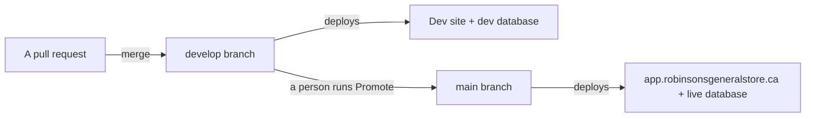

# Dev and production: two environments, and how a change crosses between them

Status: ACCEPTED, 2026-10-30. Owner: the developer. Approver: Ravi Kiran.

**Both environments exist. Production is the live site on the store's database; dev is the
`develop` branch, deployed by the same Vercel project to its own address, on a separate
database holding the repository's seed data, never the live ledger [V-run, Supabase list_projects, Vercel
create_project_env and create_deployment, GitHub create_branch, 2026-10-30].** One GitHub
secret is still missing, so a database script merged to `develop` is not yet applied to dev
by itself (step 2 below). Asked
for on 2026-07-31: build to a dev site first, test there with dummy data, and promote to
production only when Ravi says yes.

## The shape

Plain flow: a change merges into `develop`, shows up on the dev site against dummy data, and
reaches the live site only when a person runs the promotion workflow.

| | Production | Dev |
|---|---|---|
| Branch | `main` | `develop` |
| Site | `app.robinsonsgeneralstore.ca` | `robinsons-store-git-develop-robinsons-store1.vercel.app`, or `dev.robinsonsgeneralstore.ca` once its DNS record exists |
| Vercel | Project `robinsons-store`, Production environment | **The same project**, Preview environment |
| Database | Supabase project `robinsons-store` (ref `mhcjreqvvhnrtgwtuwvr`) | Supabase project `robinsons-store-dev` (ref `wqxcmchxkdhigacvxgad`), Canada Central, same organization |
| Data | The store's | Seed data, never the live ledger: `schema.sql`, `seed.sql` (its vendors, orders, invoices and payments are curated from the store's 2026 bookings sheet [R `supabase/seed.sql:4`]), `seed_dev.sql` (invented cases), then every script in `run-order.txt`. 2 stores, 46 vendors, 37 invoices on 2026-10-30 |
| Scripts | `supabase/run-order.txt`, on a push to `main` | The same list, on a push to `develop`, via `SUPABASE_DB_URL_DEV` |
| Daily email cron | Runs | Does not: Vercel runs crons on production deployments only |
| Login | Enforced (`auth_setup.sql` applied, `NEXT_PUBLIC_REQUIRE_AUTH` on) | Open demo mode: `auth_setup.sql` not run, the flag not set for Preview. Every column matches production except `app_user.auth_id`, which that script adds [V-run, information_schema on both, 2026-10-30] |
| State | BUILT | PARTIAL: steps 2 and 6 below are open |

## Three decisions, and why

**One Vercel project, not two.** The dev site is the Preview environment of the existing
project, with its own database settings. A second project would mean a second set of
variables to keep in step, and it would run the daily email cron against dev, because crons
follow a project's production branch. This replaces the 2026-07-31 plan of a second project.

**A separate Supabase project, not a test store in the live database.** Test rows in the same
tables as the real ledger, and a bad migration hitting both at once, is exactly what dev
exists to prevent. A free second project costs nothing and keeps the two apart.

**Every preview uses the dev database, not only `develop`.** A pull request preview could
write to the store's real vendors and invoices until 2026-10-30. Now Preview points at dev
for every branch, so the live database is reachable only from the live site.

Approval is a person running **Actions, Promote develop to production**
[R `.github/workflows/promote.yml:1-24`]. It opens a `develop` to `main` pull request, starts
CI on that pull request's head commit, waits for it, and merges with that commit pinned, only
if CI passed, `develop` already holds everything on `main`, and `main` is unchanged since CI
started. Anything else leaves the pull
request open and turns the run red, so production has not changed
[R `.github/workflows/promote.yml:119-168`]. After the merge it starts CI on `main`, and Apply
database scripts when the promotion touched `supabase/`, because a merge made with the
workflow's own token may start neither [R `.github/workflows/promote.yml:170-187`] [J-open:
kill condition in ADR-002 context item 3]. Nothing on a schedule can start it. Jira, which once
carried QA and Approved statuses, is off since 2026-08-12.

**CI runs on `develop` as on `main`:** every pull request into it and every push to it starts
a run by itself [R `.github/workflows/ci.yml:3-7`]. Before 2026-10-30 neither did, so pull
requests into `develop` merged with no checks unless someone started CI by hand.

## What crosses, and what does not

- **Code crosses** from `develop` to `main` by the promotion pull request.
- **Schema crosses as scripts.** Once `SUPABASE_DB_URL_DEV` is set, the same `run-order.txt`
  runs on dev first and production second [R `.github/workflows/migrate.yml:66-106`].
  Before promoting any SQL, a person confirms that the dev script run succeeded.
- **Data never crosses.** Nothing copies either way. If dev needs to look more like
  production, extend `seed_dev.sql`. `run-order.txt` may never name a seed file, and CI
  enforces that, so dummy data cannot reach any database through the pipeline.
- **The guard.** Before any script runs on dev, `.github/scripts/distinct-databases.mjs`
  stops the run if the dev connection string points at the production project.

## Turning it on

| # | What | Who | State |
|---|---|---|---|
| 1 | Project `robinsons-store-dev` in Canada Central, loaded with `schema.sql`, `seed.sql`, `seed_dev.sql` and the `run-order.txt` list, from `main` at `4dfc97c` | The developer | BUILT 2026-10-30. In the store's existing organization, not a second one: only one is reachable from here. Free costs nothing; on Pro a second project adds compute (about $10 a month) [J-open, kill condition: the Pro upgrade quote shows otherwise] |
| 2 | Repository secret `SUPABASE_DB_URL_DEV`: the dev project's **session pooler** URI on port 5432 (docs/SUPABASE_SETUP.md). Needs the dev database password: Supabase, `robinsons-store-dev`, Project settings, Database, Reset database password | admin@ | TARGET. Until it exists, a merge to `develop` reports the dev script step as `skipped` |
| 3 | Vercel Preview gets the dev database: `NEXT_PUBLIC_SUPABASE_URL` and `NEXT_PUBLIC_SUPABASE_ANON_KEY` for Preview hold the dev values; the production values are Production only | The developer | BUILT 2026-10-30. No `SUPABASE_SERVICE_ROLE_KEY` for Preview, so the Team page cannot create logins on dev; add it from the dev project's API settings if that is needed |
| 4 | Branch `develop` from `main`. The Slack autopilot now targets it, and promotion to `main` is Actions, Promote develop to production | The developer | BUILT 2026-10-30 |
| 5 | Repository variable `DEV_URL` = `https://robinsons-store-git-develop-robinsons-store1.vercel.app` | The developer | BUILT 2026-10-30 [V-run, `gh variable list`] |
| 6 | Let Ravi open the dev site. Preview addresses need a Vercel login on the team; or add `dev.robinsonsgeneralstore.ca` to the project for branch `develop` and ask Vianet for its CNAME by phone, since custom domains skip the login | Ravi Kiran | TARGET |

**Keep `develop` level with `main`.** Anything merged straight to `main` (this change, for
one) must also reach `develop`. Open a `main` to `develop` pull request after any such merge.
The promotion refuses to merge until it has, because otherwise CI on `develop` would not have
checked what lands on `main`.

**Check it worked:** the dev site lists the `DEV` vendors from `seed_dev.sql`, and nothing
entered on the live site since the seed. After step 2,
Actions, Apply database scripts, on `develop`: the gate prints a non-zero length for the dev
secret and the guard passes.

## What could still go wrong

- **The dev site pointed at the live database.** A copy-paste mistake in Vercel's Preview
  variables. The Preview `NEXT_PUBLIC_SUPABASE_URL` must end in `wqxcmchxkdhigacvxgad`, the
  Production one in `mhcjreqvvhnrtgwtuwvr`.
- **Login differs.** Dev runs open; production enforces login. A change to sign-in or
  policies is not tested by dev until `auth_setup.sql` is run there and Preview gets
  `NEXT_PUBLIC_REQUIRE_AUTH=true` with dev logins.
- **Schemas drifting.** The pipeline runs the same list on both, but a script run by hand in
  one and not the other drifts them. `/api/health` on each site catches it.
- **Works on dummy data, fails on real data.** Dev holds hundreds of rows; production holds
  the full ledger. Volume bugs still reach production first.

## How this maps to the rest of the docs

Accounts and every secret: docs/HANDOVER.md. Script order and the connection string:
docs/SUPABASE_SETUP.md. The automation that targets `develop`: docs/LOOP_ENGINEERING.md and
docs/SLACK_AUTOPILOT.md. Services and plans: docs/PLATFORM.md.

**Basis: 11 claims checked this session (2026-10-30), 11 confirmed, 0 killed, 4 sources.**
Confirmed: the dev project exists in Canada Central and is healthy; the load counts; every
public table has RLS on dev; the `documents` bucket exists on dev; the column-by-column match
with production apart from `app_user.auth_id`; the Preview variables point at dev and the
Production ones are Production only; `develop` exists at `4dfc97c`; the first `develop`
deployment was assigned `robinsons-store-git-develop-robinsons-store1.vercel.app` in `yul1`;
the promotion workflow is started by hand only; migrate picks `SUPABASE_DB_URL_DEV` on
`develop` and runs the guard first [R `.github/workflows/migrate.yml:66-106`]. Not checked:
Vercel's crons-on-production-only rule and the Pro compute charge for a second project, both
`[J-open]`. Sources: Supabase API, Vercel API, GitHub API, this repository.
Added the same day, with CI on `develop` and the promotion's merge step: 4 claims checked, 4
confirmed (the trigger lists, the merge step's guards and order, the post-merge dispatches,
and that no `claude/great-johnson-CFSbi` branch exists [V-run, `git ls-remote --heads origin`,
2026-10-30]); the merge step was run against a stubbed `gh` in eight cases (docs/VERIFICATION.md).
Still `[J-open]`: that a merge made with the workflow's token starts no push workflow.
