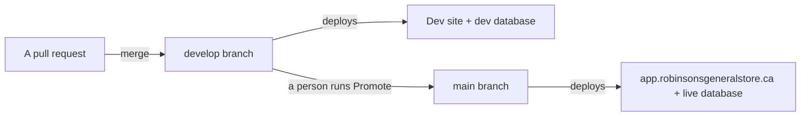

# Dev and production: two environments, and how a change crosses between them

Status: ACCEPTED, 2026-10-30. Owner: the developer. Approver: Ravi Kiran.

**Both environments exist. Production is the live site on the store's database; dev is the
`develop` branch, deployed by the same Vercel project to its own address, on a separate
database that holds a copy of production's data as of 2026-10-30, staff and pay included,
and requires login exactly as production does [V-run, Supabase project list, row counts and
per-table checksums on both projects, Vercel deployment read, 2026-10-30].** One GitHub
secret is still missing, so a database script merged to `develop` is not yet applied to dev
by itself (step 2 below). Asked
for on 2026-07-31: build to a dev site first, test there, and promote to
production only when Ravi says yes.

## The shape

Plain flow: a change merges into `develop`, shows up on the dev site against a copy of the
store's data, and reaches the live site only when a person runs the promotion workflow.

| | Production | Dev |
|---|---|---|
| Branch | `main` | `develop` |
| Site | `app.robinsonsgeneralstore.ca` | `robinsons-store-git-develop-robinsons-store1.vercel.app`, or `dev.robinsonsgeneralstore.ca` once its DNS record exists |
| Vercel | Project `robinsons-store`, Production environment | **The same project**, Preview environment |
| Database | Supabase project `robinsons-store` (ref `mhcjreqvvhnrtgwtuwvr`) | Supabase project `robinsons-store-dev` (ref `wqxcmchxkdhigacvxgad`), Canada Central, same organization |
| Data | The store's | A copy of production taken 2026-10-30 at 19:47 UTC: every `public` table and the login accounts (`auth.users`, `auth.identities`), staff, pay rates and shifts included. 1,469 rows, equal to production in count and checksum on all 29 tables [V-run, count and md5 per table on both projects, 2026-10-30]. Invoice photos and voice notes were not copied, so those links do not open on dev. Before the copy dev held seed data (`schema.sql`, `seed.sql`, `seed_dev.sql`, the `run-order.txt` scripts) |
| Scripts | `supabase/run-order.txt`, on a push to `main` | The same list, on a push to `develop`, via `SUPABASE_DB_URL_DEV` |
| Daily email cron | Runs | Does not: Vercel runs crons on production deployments only |
| Login | Enforced (`auth_setup.sql` applied, `NEXT_PUBLIC_REQUIRE_AUTH` on) | Enforced the same way since 2026-10-30: `auth_setup.sql` applied, no `dev_all` policy left, every public table has RLS on and at least one policy, and the dev public key reads no rows; `NEXT_PUBLIC_REQUIRE_AUTH=true` for Preview [V-run, pg_policies and a query as the `anon` role on dev, Vercel env create, 2026-10-30]. Production's logins were copied, so the same email and password should open dev [J-open, kill condition: a production login fails on the dev site]. Policies, the three money-free views and the `app_auth` functions match production since `money_by_role.sql` and `documents_by_role.sql` were applied to dev at 22:50 UTC, apart from `ai_call`'s `owner_read`, which only dev has [V-run, pg_policies and the catalog on both projects, 2026-10-30] |
| State | BUILT | PARTIAL: steps 2 and 6 below are open |

## Four decisions, and why

**One Vercel project, not two.** The dev site is the Preview environment of the existing
project, with its own database settings. A second project would mean a second set of
variables to keep in step, and it would run the daily email cron against dev, because crons
follow a project's production branch. This replaces the 2026-07-31 plan of a second project.

**A separate Supabase project, not a test store in the live database.** Test rows in the same
tables as the real ledger, and a bad migration hitting both at once, is exactly what dev
exists to prevent. A free second project costs nothing and keeps the two apart.

**Every preview uses the dev database, not only `develop`.** A pull request preview could
write to the store's real vendors and invoices until 2026-10-30. Now Preview points at dev
for every branch, so the live database is reachable only from the live site. Every preview
also requires login, because `NEXT_PUBLIC_REQUIRE_AUTH` is set for Preview as a whole.

**Dev holds a copy of production, behind login.** Changed on 2026-10-30. Seed data could not
show how a change behaves on the store's real vendors, departments and invoices; a copy can.
Because the copy includes staff and pay, dev runs the same policies and login as production,
so the dev public key alone reads nothing.

Approval is a person running **Actions, Promote develop to production**
[R `.github/workflows/promote.yml:1-24`]. It opens a `develop` to `main` pull request, starts
CI on that pull request's head commit, waits for it, and merges with that commit pinned, only
if CI passed, `develop` already holds everything on `main`, and `main` is unchanged since CI
started. Anything else leaves the pull
request open and turns the run red, so production has not changed
[R `.github/workflows/promote.yml:119-168`]. After the merge it starts CI on `main`, and Apply
database scripts when the promotion touched `supabase/`, because a merge made with the
workflow's own token may start neither [R `.github/workflows/promote.yml:170-187`] [J-open:
kill condition in ADR-002 context item 3]. Nothing on a schedule can start it. Jira, which once
carried QA and Approved statuses, is off since 2026-08-12.

**CI runs on `develop` as on `main`:** every pull request into it and every push to it starts
a run by itself [R `.github/workflows/ci.yml:3-7`]. Before 2026-10-30 neither did, so pull
requests into `develop` merged with no checks unless someone started CI by hand.

## What crosses, and what does not

- **Code crosses** from `develop` to `main` by the promotion pull request.
- **Schema crosses as scripts.** Once `SUPABASE_DB_URL_DEV` is set, the same `run-order.txt`
  runs on dev first and production second [R `.github/workflows/migrate.yml:66-106`].
  Before promoting any SQL, a person confirms that the dev script run succeeded.
- **Data crosses one way, by hand.** On 2026-10-30 dev's tables and logins were replaced with
  a copy of production's (the table above). Nothing copies on its own, and nothing ever goes
  from dev to production. `run-order.txt` may never name a seed file, and CI enforces that,
  so seed data cannot reach any database through the pipeline. A fresh copy is the same job
  by hand: empty dev's tables, load production's rows as the database owner, then compare
  counts and checksums table by table.
- **The guard.** Before any script runs on dev, `.github/scripts/distinct-databases.mjs`
  stops the run if the dev connection string points at the production project.

## Turning it on

| # | What | Who | State |
|---|---|---|---|
| 1 | Project `robinsons-store-dev` in Canada Central, loaded with `schema.sql`, `seed.sql`, `seed_dev.sql` and the `run-order.txt` list, from `main` at `4dfc97c` | The developer | BUILT 2026-10-30. In the store's existing organization, not a second one: only one is reachable from here. Free costs nothing; on Pro a second project adds compute (about $10 a month) [J-open, kill condition: the Pro upgrade quote shows otherwise] |
| 2 | Repository secret `SUPABASE_DB_URL_DEV`: the dev project's **session pooler** URI on port 5432 (docs/SUPABASE_SETUP.md). Needs the dev database password: Supabase, `robinsons-store-dev`, Project settings, Database, Reset database password | admin@ | TARGET. Until it exists, a merge to `develop` reports the dev script step as `skipped` |
| 3 | Vercel Preview gets the dev database: `NEXT_PUBLIC_SUPABASE_URL` and `NEXT_PUBLIC_SUPABASE_ANON_KEY` for Preview hold the dev values; the production values are Production only | The developer | BUILT 2026-10-30. No `SUPABASE_SERVICE_ROLE_KEY` for Preview, so the Team page cannot create logins on dev, and `/api/health` on dev reads as a signed-out caller, so its row checks see no rows now that login is on [R `src/app/api/health/route.ts:110-116`]; add the key from the dev project's API settings if either is needed |
| 4 | Branch `develop` from `main`. The Slack autopilot now targets it, and promotion to `main` is Actions, Promote develop to production | The developer | BUILT 2026-10-30 |
| 5 | Repository variable `DEV_URL` = `https://robinsons-store-git-develop-robinsons-store1.vercel.app` | The developer | BUILT 2026-10-30 [V-run, `gh variable list`] |
| 6 | Let Ravi open the dev site. Preview addresses need a Vercel login on the team; or add `dev.robinsonsgeneralstore.ca` to the project for branch `develop` and ask Vianet for its CNAME by phone, since custom domains skip the login | Ravi Kiran | TARGET |
| 7 | Dev holds a copy of production and requires login: `department_field.sql` then `auth_setup.sql` applied from branch `department-field-settings` at `0269970`, every `public` table and the login accounts copied, `NEXT_PUBLIC_REQUIRE_AUTH=true` for Preview, `develop` redeployed at `cae5104`; later the same day `money_by_role.sql` and `documents_by_role.sql` from `develop` at `fad4b62` applied by hand, as the dev script workflow would | The developer | BUILT 2026-10-30 [V-run, script hashes against the branch copies, per-table counts and checksums, Vercel deployment READY on the git-develop alias in `yul1`] |

**Keep `develop` level with `main`.** Anything merged straight to `main` (this change, for
one) must also reach `develop`. Open a `main` to `develop` pull request after any such merge.
The promotion refuses to merge until it has, because otherwise CI on `develop` would not have
checked what lands on `main`.

**Check it worked:** signed out, the dev site opens on its login page; signed in with a store
login, it lists the store's vendors as they stood at the copy, and nothing entered on the
live site since. After step 2,
Actions, Apply database scripts, on `develop`: the gate prints a non-zero length for the dev
secret and the guard passes.

## What could still go wrong

- **The dev site pointed at the live database.** A copy-paste mistake in Vercel's Preview
  variables. The Preview `NEXT_PUBLIC_SUPABASE_URL` must end in `wqxcmchxkdhigacvxgad`, the
  Production one in `mhcjreqvvhnrtgwtuwvr`.
- **The copy goes stale.** Dev holds production as of 2026-10-30 19:47 UTC. Anything entered
  on the live site after that is missing on dev, including a login added later, until the
  next copy; anything entered on dev never reaches production.
- **Schemas drifting.** The pipeline runs the same list on both, but a script run by hand in
  one and not the other drifts them. `/api/health` on each site catches it.

## How this maps to the rest of the docs

Accounts and every secret: docs/HANDOVER.md. Script order and the connection string:
docs/SUPABASE_SETUP.md. The automation that targets `develop`: docs/LOOP_ENGINEERING.md and
docs/SLACK_AUTOPILOT.md. Services and plans: docs/PLATFORM.md.

**Basis: 17 claims checked this session (2026-10-30), 17 confirmed, 0 killed, 4 sources.**
Confirmed: both projects by name, same organization, `ca-central-1`; `department_field.sql`
and `auth_setup.sql` byte-identical to the branch copies at `0269970` when applied; no
`dev_all` policy on dev; all 28 public tables on dev have RLS on and at least one policy;
`department_field` has `member_read`, `manager_insert` and `manager_update`; the `anon` role
reads 0 rows from vendor, employee, pay_rate, shift and invoice on dev; the copy's time; row
counts equal on all 29 tables; checksums equal on all 29 tables; the two linked `app_user`
rows point at login accounts that exist on dev; `NEXT_PUBLIC_REQUIRE_AUTH` created for
Preview; `develop` redeployed READY at `cae5104` on the git-develop alias in `yul1`; the dev
`/api/health` answered `ok:true` with all eight checks; a signed-out visit to the dev site
lands on `/login`; without a service-role key the health route uses the signed-out client;
`money_by_role.sql` and `documents_by_role.sql` byte-identical to `fad4b62` when applied to
dev; afterwards dev's policies, views and `app_auth` objects equal production's apart from
`ai_call`'s `owner_read`.
Not checked: signing in to dev with a production login, `[J-open]` above.
Claims from earlier sessions keep their own inline tags. Sources: Supabase API, Vercel API,
the dev site, this repository.
Added the same day, with CI on `develop` and the promotion's merge step: 4 claims checked, 4
confirmed (the trigger lists, the merge step's guards and order, the post-merge dispatches,
and that no `claude/great-johnson-CFSbi` branch exists [V-run, `git ls-remote --heads origin`,
2026-10-30]); the merge step was run against a stubbed `gh` in eight cases (docs/VERIFICATION.md).
Still `[J-open]`: that a merge made with the workflow's token starts no push workflow.
