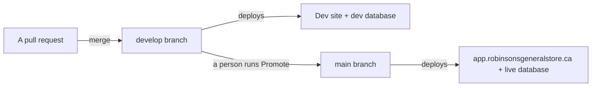

# Dev and production: two environments, and how a change crosses between them

Status: ACCEPTED, 2026-10-30. Owner: the developer. Approver: Ravi Kiran.

**Production is BUILT. The dev environment is not: there is no `develop` branch and no dev
database yet [V-run, GitHub list_branches, 2026-10-30], and every pull request preview reads
and writes the live database today [V-run, Vercel filter_project_envs: the Supabase URL and
key target Production and Preview, 2026-10-30].** The workflows that run dev are built and
waiting. Three settings, done in the order below, turn it on. Asked for on 2026-07-31: build
to a dev site first, test there with dummy data, and promote to production only when Ravi
says yes.

## The shape

Plain flow: a change merges into `develop`, shows up on the dev site against dummy data, and
reaches the live site only when a person runs the promotion workflow.

| | Production | Dev |
|---|---|---|
| Branch | `main` | `develop` |
| Site | `app.robinsonsgeneralstore.ca` | `robinsons-store-git-develop-robinsons-store1.vercel.app`, or `dev.robinsonsgeneralstore.ca` once its DNS record exists |
| Vercel | Project `robinsons-store`, Production environment | **The same project**, Preview environment |
| Database | Supabase project `robinsons-store` (ref `mhcjreqvvhnrtgwtuwvr`) | A second Supabase project, `robinsons-store-dev`, in a separate Free organization owned by admin@ |
| Data | The store's | Invented, from `supabase/seed_dev.sql` |
| Scripts | `supabase/run-order.txt`, on a push to `main` | The same list, on a push to `develop`, via `SUPABASE_DB_URL_DEV` |
| Daily email cron | Runs | Does not: Vercel runs crons on production deployments only |
| State | BUILT | TARGET |

## Three decisions, and why

**One Vercel project, not two.** The dev site is the Preview environment of the existing
project, with its own database settings. A second project would mean a second set of
variables to keep in step, and it would run the daily email cron against dev, because crons
follow a project's production branch. This replaces the 2026-07-31 plan of a second project.

**A separate Supabase project, not a test store in the live database.** Test rows in the same
tables as the real ledger, and a bad migration hitting both at once, is exactly what dev
exists to prevent. A free second project costs nothing and keeps the two apart.

**Every preview uses the dev database, not only `develop`.** Today a pull request preview
can write to the store's real vendors and invoices. Once dev exists, Preview points at dev
for every branch, so the live database is reachable only from the live site.

Approval is a person running **Actions, Promote develop to production**: it opens and merges
a `develop` to `main` pull request once the checks pass [R `.github/workflows/promote.yml:1-21`].
Nothing on a schedule can start it. Jira, which once carried QA and Approved statuses, is off
since 2026-08-12.

## What crosses, and what does not

- **Code crosses** from `develop` to `main` by the promotion pull request.
- **Schema crosses as scripts.** The same `run-order.txt` runs on dev first and production
  second, so every migration is exercised on dev before it touches the ledger.
- **Data never crosses.** Nothing copies either way. If dev needs to look more like
  production, extend `seed_dev.sql`. `run-order.txt` may never name a seed file, and CI
  enforces that, so dummy data cannot reach any database through the pipeline.
- **The guard.** Before any script runs on dev, `.github/scripts/distinct-databases.mjs`
  stops the run if the dev connection string points at the production project.

## Turning it on

Do these in order. Until step 3, nothing changes for production or for the autopilots.

| # | What | Who | Where |
|---|---|---|---|
| 1 | Create a Free organization and in it a project `robinsons-store-dev`, region Canada Central. Run `schema.sql`, then `seed.sql`, then `seed_dev.sql` in its SQL editor | admin@ | supabase.com |
| 2 | Add repository secret `SUPABASE_DB_URL_DEV`: the dev project's **session pooler** URI on port 5432 (docs/SUPABASE_SETUP.md) | admin@ or the developer | GitHub, Settings, Secrets and variables, Actions |
| 3 | In Vercel, project `robinsons-store`, Environment Variables: change `NEXT_PUBLIC_SUPABASE_URL` and `NEXT_PUBLIC_SUPABASE_ANON_KEY` to **Production only**, then add both again for **Preview** with the dev project's values, plus a dev `SUPABASE_SERVICE_ROLE_KEY` for Preview. Redeploy one preview and check its URL ends in the dev project ref | The developer | vercel.com |
| 4 | Create branch `develop` from `main`. From here the Slack autopilot targets `develop`, and pushes there run the dev scripts | The developer | GitHub |
| 5 | Add repository variable `DEV_URL` = `https://robinsons-store-git-develop-robinsons-store1.vercel.app` | The developer | GitHub, Settings, Variables |
| 6 | Let Ravi open the dev site. Either add him to the Vercel team (preview addresses require a Vercel login), or add domain `dev.robinsonsgeneralstore.ca` to the project for branch `develop` and ask Vianet for its CNAME by phone; custom domains skip the login | Ravi Kiran | vercel.com, Vianet |

**Check it worked:** Actions, Apply database scripts, on `develop`: the gate prints a
non-zero length for the dev secret and the guard passes. Then a pull request preview shows
the dev vendors, not the store's.

## What could still go wrong

- **The dev site pointed at the live database.** A copy-paste mistake in step 3. Compare the
  Preview `NEXT_PUBLIC_SUPABASE_URL` with the Production one before trusting anything.
- **Schemas drifting.** The pipeline runs the same list on both, but a script run by hand in
  one and not the other drifts them. `/api/health` on each site catches it.
- **Works on dummy data, fails on real data.** Dev holds hundreds of rows; production holds
  the full ledger. Volume bugs still reach production first.

## How this maps to the rest of the docs

Accounts and every secret: docs/HANDOVER.md. Script order and the connection string:
docs/SUPABASE_SETUP.md. The automation that targets `develop`: docs/LOOP_ENGINEERING.md and
docs/SLACK_AUTOPILOT.md. Services and plans: docs/PLATFORM.md.

**Basis: 5 claims checked this session (2026-10-30), 5 confirmed, 0 killed, 3 sources.**
Confirmed: no `develop` branch; the Supabase URL and key target Production and Preview; the
team slug `robinsons-store1` that the dev address is built from; the promotion workflow is
started by hand only; migrate picks `SUPABASE_DB_URL_DEV` on `develop` and runs the guard
first [R `.github/workflows/migrate.yml:66-106`]. Not checked: Vercel's cron-on-production
rule and branch alias format were taken from prior use, not read this session, `[J-open]`,
kill condition: the dev site's address differs after step 4 or a cron fires on a preview.
Sources: GitHub API, Vercel API, this repository.
